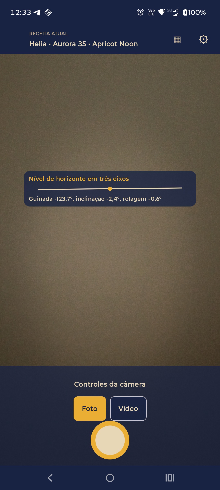
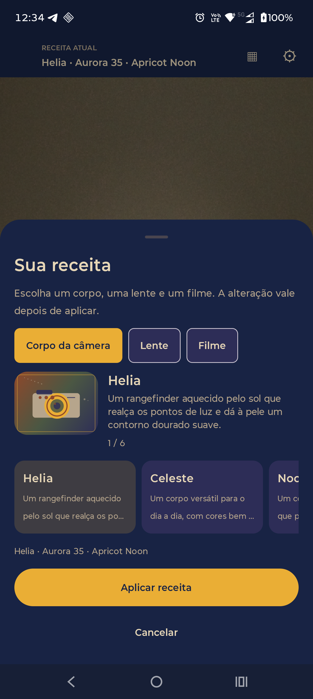
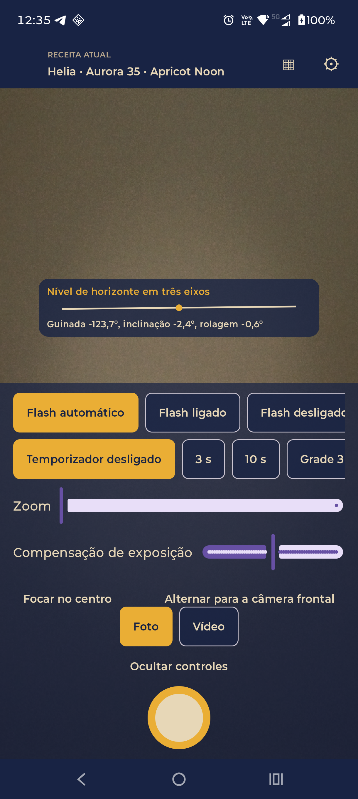
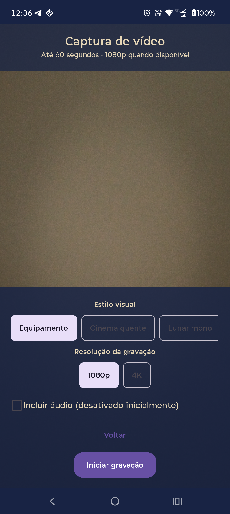

# Android screen presentation

These screenshots show the camera-first Android interface running on a physical Motorola Edge 60. They are direct device captures from the installed app (`1220 × 2712` pixels); no sample mockups were used.

## Camera

The camera opens on the active recipe and live preview. Secondary controls are collapsed so Photo/Video selection and the shutter stay close to the preview.

## Edit the recipe

The recipe sheet keeps the camera context visible while the user browses camera bodies, lenses, and film stocks. The selected combination can be applied or canceled.

## Camera controls

Flash, timer, grid, zoom, exposure, focus, and camera switching are available in the expanded controls panel.

## Video setup

Video settings are available in the same camera flow. This capture shows the setup screen; recording was not started.

See [the interface redesign notes](../../interface-redesign.md) for the navigation decisions and tested journeys.
