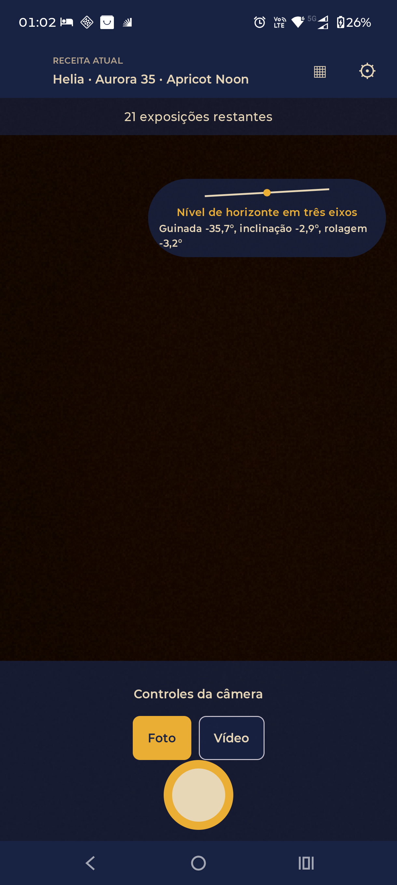

# Android screen presentation

These screenshots show the refreshed camera-first Android interface running on a physical Motorola Edge 60. They are direct captures from the installed app (`1220 × 2712` pixels); no sample mockups were used. The live preview shows the scene in front of the device at capture time; these documentation captures did not take a photo or start a recording.

## Camera

The camera opens on the active recipe and live preview. Secondary controls are collapsed so Photo/Video selection and the shutter stay close to the preview. The horizon indicator stays compact at the preview edge; tap it to reveal yaw, pitch, and roll.

## Edit the recipe

The recipe sheet keeps the camera context visible while the user browses camera bodies, lenses, and film stocks. The active catalog item has a clear gold selection state; the selected combination can be applied or canceled.

## Camera controls

Flash, timer, grid, zoom, exposure, focus, and camera switching are available in the expanded controls panel. Choice chips wrap to keep their labels whole at the device's large text size; scroll the panel to reach the lower controls.

## Video setup

Video settings are available in the same camera flow. Selected and available options use the Théia palette, and choice chips wrap when needed. This capture shows the setup screen; recording was not started.

See [the interface redesign notes](../../interface-redesign.md) for the navigation decisions and tested journeys.
